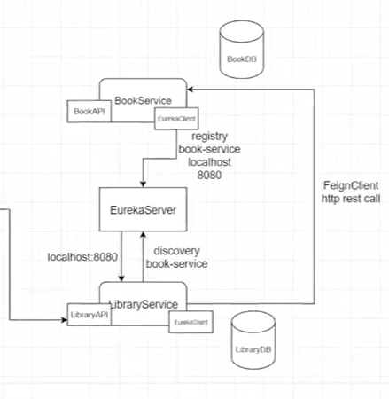
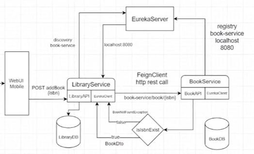

# ABOUT THIS MICROSERVICES PROJECT

* This project allows to save and take notes about books you read, movies you watch.   
* Only API that open to outer word is LibraryAPI. LibraryAPI calls BookAPI with feign client.  

## TODO

* What can you use instead of eureka server? 
  * docker-compose for services you don't change much + application-LOCAL.yml for you debug  
  * Or application-LOCAL.yml for every service + run from ide
* Add application-LOCAL.yml to .gitignore
* swagger api doc
* Migrate from Zipkin to OTEL(LGTM) and/or ELK
* docker-compose for Vault
* Add VAULT_ADDR and VAULT_TOKEN to env var
* Release notes, wiki
* Redis
* Add config yml files
* Notification service with RabbitMQ or Kafka

## Install

Clone the project

```bash
  git clone https://github.com/KubraBoduroglu/culture-library.git
``` 

Go to the project directory

```bash
  cd culture-library
```

Install dependencies

```bash
  npm install
```

Start the server

```bash
  npm run start
```


## Usage

* Run library service and create new library.

````bash
POST http://localhost:8080/v1/library/
Request Body:
{id}

````

* Send this id and an isbn that doesn't in library to create new record in library.
* Default values should be inserted if no valid isbn sent. 

````bash
PUT http://localhost:8080/v1/library/
Request Body:
{id}
{isbn}

````

* Check if books added in the library.

````bash
GET http://localhost:8080/v1/library/{id}

````

## DEVELOPMENT DOCUMENTATION

### Eureka Server

* Eureka Server is a `service registry`, a service discovery tool that allows services to find and communicate with each other
* EurekaServerApplication should have the `@EnableEurekaServer` annotation in eureka-server module.  
* eureka-server module should have the `spring-cloud-starter-netflix-eureka-server` dependency.  
* Other modules needed `@EnableEurekaClient` or ` @EnableDiscoveryClient` before, but not anymore.  
* Other modules should have the `spring-cloud-starter-netflix-eureka-client` dependency.
* Other modules should have the `eureka.client.service-url.default-zone` in application.properties.  

* Every eureka client has a local service registry. And even if eureka server not up and running these client services can communicate with each other using local service registries. It is  called  a fallback mechanism. If ip ports of the services change this solution doesn't work anymore. 

### Communication Between Services using Feign Client

* Services that communicate with each other needs to have `spring-cloud-starter-openfeign` dependency.  
* `@FeignClient` annotation should be used by clients.  
* Feign Client is an interface.  
* `@EnableFeignClients` annotation should be used by clients.
* When adding book to the library, LibraryService send request to the BookService with isbn. LibraryService never holds all book info but only holds book ids, BookService holds the info about books.



### What If No Book Found from BookService
#### Error Handling with Feign Client

* RetrieveMessageErrorDecoder should be added to LibraryServiceApplication.class to handled by Spring Boot.
* Record creates immutable final classes with constructors and getter setters. Allows us to get rid of boilerplate code.  
* Why use Kotlin instead of Record for entities? 
  * Since Record is final, it cannot be used by Spring JPA. Spring JPA needs one constructor without parameters.  
  * Record cannot be extended.

#### Fault Tolerance and Fallback Methods

* Another way for fault tolerance is fallback methods with resilience4j.
* resilience4j dependency, `CircuitBreaker` annotation and fallback methods were added.
* Creating different fallback situations for different errors.
* Netflix Hystrix is deprecated, used resilience4j.
* Parameters of fallback methods are always feign client parameters and exception message.
* Default values should be inserted if no valid isbn sent.
* `CircuitBreaker` -> If one of the services is is not responding, the circuit breaker stops repeatedly sending requests to it. This prevents wasted resources, long wait times, and system-wide failures.

### Why Kotlin?
* Default immutability. 
* No need for Lombok. No headaches for lombok version incompatibility and lombok generated classes.



### Api Gateway 
* Scale Up: More than one instance of services to be able to handle requests.
* `Load Balancing`: Redirect requests to service instances according to load.
* Routing in `application.yml` in `api-gateway`.
* `id` in `routes` should be same with service names. 
* Web Interceptors + Web Filters
* Start 2 library-service instance from terminal: 
 ````bash
mvn spring-boot:run
````

### System Design Until Now


### Spring Actuator
* Actuator configs are placed under `management` keyword in application.yml and application.properties files.
* If nothing exposed explicitly, `health` endpoint exposed by default.
* Metrics are drived from Actuator endpoints.

### Distributed Log Trace

* Used for tracing request logs between services. 
* Start Zipkin via Docker.
````bash
docker run -d -p 9411:9411 openzipkin/zipkin
````
* Once the server is running, you can view traces with the Zipkin UI at http://your_host:9411/zipkin/.

### Centralized Configuration with Spring Cloud Config
* Using config repository, instead of change and deploy every microservice, config initialization and change done in central repo.
* SprinCloudCOnfigServer -> configs
* Configs can be stored in 3 different ways: file based in project classpath, git repo, Vault.
* To fetch config file:
`````bash
http:localhost/8888/book-service/dev
`````
* Test which value from which config file is in use:
`````bash
http:localhost/8889/v1/library/count
`````
* If git repo option has been used and config files has been changed, send post request to `actuator/refresh` endpoint and add `@RefreshScope` to controller for config change takes place.
* Changes occur without the need of restarting the service.
`````bash
POST http:localhost/8090/actuator/refresh
`````

### System Design Until Now


* Why Gradle -> faster build, groovy scrip instead of xml

### Spring Cloud Config and Vault Integration
* Kullanıcı adı, şifre gibi secret'ları tek ve güvenli bir yerden yönetmek için. 
* Projelerin içinde hassas bilgileri tutmamış olacağız.
* Using Vault instead of Spring Cloud Config.
* `config` directory not in use anymore.
* Unseal Vault
* Test which value from which config file/Vault is in use:
`````bash
http:localhost/8889/v1/library/count
`````

### Communication Between Services using SpringBoot and gRPC
* gRPC instead of Feign Client.
* gRPC not use http, uses proto buff (http6), a byte protocol.
* Proto buffs written in gRPC library, maven uses this library and creates interfaces and models.
* gRPC client (stub) uses this interfaces that the implementations has been done in gRPC server. (Reminds me old soap stubs.)
* gRPC request vs rest request:
  * Rest request: `curl GET localhost:8081/v1/library`
  * gRPC request : `grpcurl com.kitaplik.book-service.BookGrpcService.getBookByIsbn -d isbn 123432`
* gRPC library transforms byte arrays coming from these requests to objects.
* 

------------  

## RESOURCES

1. [Spring Microservices](https://youtube.com/playlist?list=PLCp1YoRkzkpZ3OinTeT2-8A1B7HAujTAu&si=OvpAnIzaqpY0Npu-)
2. [Spring Boot Microservices Project Example - Part 3 | Service Discovery](https://youtu.be/0TQliqoX6Kc?si=Szqo5KhgyXZUqPW-&t=209)
3. [resilience4j](https://resilience4j.readme.io/docs/getting-started)
4. https://hub.docker.com/r/openzipkin/zipkin
5. https://docs.spring.io/spring-boot/reference/actuator/tracing.html#actuator.micrometer-tracing.tracer-implementations.brave-zipkin
6. [Java SpringCloud Microservice Egitimi](https://youtube.com/playlist?list=PLd0jsEi3hUAdKnXFDDop8V9WfBzHD5WLF&si=l0bV3vsBocxeuhbg)