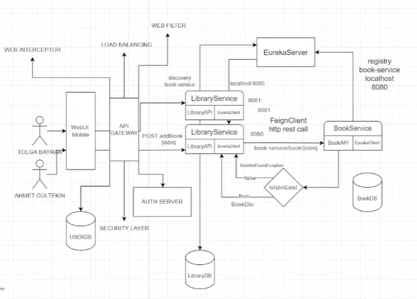
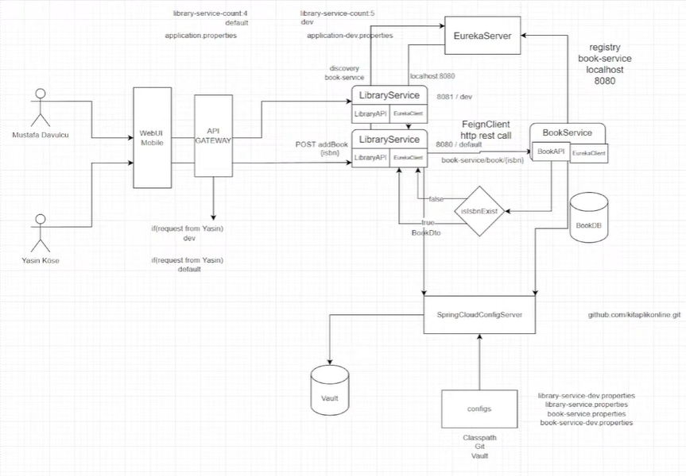

# ABOUT THIS MICROSERVICES PROJECT

* This project allows to save and take notes about books you read, movies you watch.   
* Only API that open to outer word is LibraryAPI. LibraryAPI calls BookAPI with feign client.  

## TODO

* What can you use instead of eureka server? 
  * docker-compose for services you don't change much + application-LOCAL.yml for you debug  
  * Or application-LOCAL.yml for every service + run from ide
* Add application-LOCAL.yml to .gitignore
* swagger api doc
* Migrate from Zipkin to OTEL(LGTM) and/or ELK
* docker-compose for Vault
* Add VAULT_ADDR and VAULT_TOKEN to env var
* Release notes, wiki
* Redis
* Add config yml files
* Notification service with RabbitMQ or Kafka
* Is it enough to initialize eureka dependency only in config server?

## Install

Clone the project

```bash
  git clone https://github.com/KubraBoduroglu/culture-library.git
``` 

Go to the project directory

```bash
  cd culture-library
```

Install dependencies

```bash
  npm install
```

Start the server

```bash
  npm run start
```


## Usage

* Run eureka server, gateway service. 
* Run library service and create new library.

- Start 
  C:\Program Files\Java\jdk-21\bin\java.exe -Dfile.encoding=UTF-8 -Dsun.stdout.encoding=UTF-8 -Dsun.stderr.encoding=UTF-8 com.culture_lib.book_service.BookServiceApplication

  cd /d D:\private_git_repos\culture-library\book-service\src\main\java\com\culture_lib\book_service\ && mvn

````bash
POST http://localhost:8080/v1/library/
Request Body:
{id}
````

* Send this id and an isbn that doesn't in library to create new record in library.
* Default values should be inserted if no valid isbn sent. 

````bash
PUT http://localhost:8080/v1/library/
Request Body:
{id}
{isbn}
````

* Check if books added in the library.

````bash
GET http://localhost:8080/v1/library/{id}

````

## DEVELOPMENT DOCUMENTATION

### Service Discovery Using Eureka Server

* Eureka Server is a `service registry`, a service discovery tool that allows services to find and communicate with each other.
* Service discovery: Proccess of automatically detecting devices and services on a network. 
* In eureka-server module: 
  * Add `spring-cloud-starter-netflix-eureka-server` dependency.
  * Main class have the `@EnableEurekaServer` annotation.
* In other modules that will register in eureka-server: 
  * `spring-cloud-starter-netflix-eureka-client` dependency.
  * In earlier versions should have `@EnableEurekaClient` or ` @EnableDiscoveryClient` before, but not needed anymore.
  * `eureka.client.service-url.default-zone` in application.properties.  

* Every eureka client has a local service registry. And even if eureka server not up and running these client services can communicate with each other using local service registries. It is  called  a fallback mechanism. If ip ports of the services change this solution doesn't work anymore. 
* Eureka UI:
````bash
http:localhost/8761
````

### Communication Between Services 
#### Feign Client

* Services that communicate with each other needs to have `spring-cloud-starter-openfeign` dependency.  
* `@FeignClient` annotation should be used by clients.  
* Feign Client is an interface.  
* `@EnableFeignClients` annotation should be used by clients.

### What If No Book Found from BookService
#### Error Handling with Feign Client

* RetrieveMessageErrorDecoder should be added to LibraryServiceApplication.class to handled by Spring Boot.
* Record creates immutable final classes with constructors and getter setters. Allows us to get rid of boilerplate code.  
* Why use Kotlin instead of Record for entities? 
  * Since Record is final, it cannot be used by Spring JPA. Spring JPA needs one constructor without parameters.  
  * Record cannot be extended.

#### Fault Tolerance and Fallback Methods

* Another way for fault tolerance is fallback methods with `resilience4j`.
* `resilience4j` dependency, `CircuitBreaker` annotation and fallback methods were added.
* Creating different fallback situations for different errors.
* Netflix Hystrix is deprecated, used `resilience4j`.
* Parameters of fallback methods are always feign client parameters and exception message.
* Default values should be inserted if no valid isbn sent.
* `CircuitBreaker` -> If one of the services is is not responding, the circuit breaker stops repeatedly sending requests to it. This prevents wasted resources, long wait times, and system-wide failures.

### Why Kotlin?
* Default immutability. 
* No need for Lombok. No headaches for lombok version incompatibility and lombok generated classes.

### Api Gateway 
* Scale Up: More than one instance of services to be able to handle requests.
* Can also serve for authorization, security and load balancing aspects.
* `Load Balancing`: Redirect requests to service instances according to load.
* Routing in `application.yml` in `api-gateway`. Instance ports can change, so instead of changing in every service we do the routing in api-gateway.
* `id` in `routes` should be same with service names.
* Web Interceptors + Web Filters
* Start 2 library-service instance from terminal: 
 ````bash
mvn spring-boot:run
````

### System Design Until Now


### Spring Actuator
* Actuator configs are placed under `management` keyword in application.yml and application.properties files.
* If nothing exposed explicitly, `health` endpoint exposed by default.
* Metrics are derived from Actuator endpoints.

### Distributed Log Trace

* Used for tracing request logs between services. 
* Start Zipkin via Docker.
````bash
docker run -d -p 9411:9411 openzipkin/zipkin
````
* Once the server is running, you can view traces with the Zipkin UI at http://your_host:9411/zipkin/.

### Centralized Configuration with Spring Cloud Config
* Using config repository, instead of change and deploy every microservice, config initialization and change done in central repo.
* No need to deploy application again for new config changes.
* SpringCloudConfigServer -> configs
* Configs can be stored in 3 different ways: file based in project classpath, git repo, Vault.
* To fetch config file:
`````bash
http:localhost/8888/book-service/dev
`````
* Test which value from which config file is in use:
`````bash
http:localhost/8889/v1/library/count
`````
* If git repo option has been used and config files has been changed, send post request to `actuator/refresh` endpoint and add `@RefreshScope` to controller for config change takes place.
* Changes occur without the need of restarting the service.
`````bash
POST http:localhost/8090/actuator/refresh
`````

### System Design Until Now


* Why Gradle -> faster build, groovy scrip instead of xml

### Spring Cloud Config and Vault Integration
* Kullanıcı adı, şifre gibi secret'ları tek ve güvenli bir yerden yönetmek için. 
* Manage secrets from secure vault.
* Projelerin içinde hassas bilgileri tutmamış olacağız.
* `config` directory not in use anymore.
* Add `vault.json`
* First time starting vault server from docker compose:
  ````bash
  # Alternative 1
  docker-compose -f "D:\private_git_repos\culture-library\vault-docker-dev\docker-compose.yml" up -d
  
  # Alternative 2
  cd /d D:\private_git_repos\culture-library\vault-docker-dev && docker-compose -f docker-compose.yml up -d
  
  # Alternative 3
  cd D:\git_repos\ggecici\server\.docker
  docker compose up -d
  ````
* List docker compose containers
  ````bash
  docker-compose ps
  ````

* Start docker compose
  ````bash
  # Alternative 1
  docker compose -f "D:\private_git_repos\culture-library\vault-docker-dev\docker-compose.yml" start
  
  # Alternative 2
  # cd /d D:\private_git_repos\culture-library\vault-docker-dev && docker compose start
  
  # Alternative 3
  # cd D:\private_git_repos\culture-library\vault-docker-dev
  # docker compose start
  ````
  
* Stop docker compose
  ````bash
  # Alternative 1
  cd /d D:\git_repos\ggecici\server\.docker && docker compose stop  
  # Alternative 2
  docker compose -f "D:\private_git_repos\culture-library\vault-docker-dev\docker-compose.yml" stop  
  ````

* Vault UI:
````bash
http://localhost:8200/ui
````
* Unseal Vault after vault server up and running.
* Test which value from which config file/Vault is in use from getCount endpoint:
````bash
http:localhost/8889/v1/library/count
````
* Needs actuator/refresh if value in vault changes.
* 
------------  

## RESOURCES

1. [Spring Boot Microservices Project Example - Part 3 | Service Discovery](https://youtu.be/0TQliqoX6Kc?si=Szqo5KhgyXZUqPW-&t=209)  
2. [[TechThursday] - Microservice #2 - Spring Cloud Eureka Server/Client, Feign Client](https://www.youtube.com/live/Iv4v_1rdC9E?si=MlI8ZWQKcQCwY8XY)
3. [[TechThursday] - Microservice #3 - Spring Boot Feign Client Error Handling & Fault Tolerance](https://www.youtube.com/live/k9UTf8aaT44?si=ZFGs7FT3ki8UosRg)
4. [resilience4j](https://resilience4j.readme.io/docs/getting-started)
5. [[TechThursday] Microservice #4 - API Gateway, Spring Actuator, Distributed Log Trace, Zipkin](https://www.youtube.com/live/pSs9v_uo2Qo?si=TZCbyMTL0YbK9W92)
6. https://hub.docker.com/r/openzipkin/zipkin
7. https://docs.spring.io/spring-boot/reference/actuator/tracing.html#actuator.micrometer-tracing.tracer-implementations.brave-zipkin
8. [#5 - Spring Cloud Config ile Centralized Configuration](https://www.youtube.com/live/knZe2Vbk7HE?si=YC85CyRod4IX3_Bk)
9. [#6 - Spring Cloud Config ile Vault Integration](https://www.youtube.com/live/PlU4YKtuAfw?si=0dnpROWSlI_vvQNt)
10. [Java SpringCloud Microservice Egitimi](https://youtube.com/playlist?list=PLd0jsEi3hUAdKnXFDDop8V9WfBzHD5WLF&si=l0bV3vsBocxeuhbg)
11. [Vault Docker Image](https://hub.docker.com/r/hashicorp/vault)
12. [Run Vault on Docker](https://developer.hashicorp.com/vault/docs/deploy/run-on-docker)
13. [Telusko Microservices Tutorial for Beginners](https://youtu.be/h6aDu9e2L_s?si=DkuAOkV1JQoMGWRr)
14. [navinreddy20/MicroserviceTutorials](https://github.com/navinreddy20/MicroserviceTutorials.git)
15. [How to Use Vault with Docker](https://oneuptime.com/blog/post/2026-02-02-vault-docker/view)
